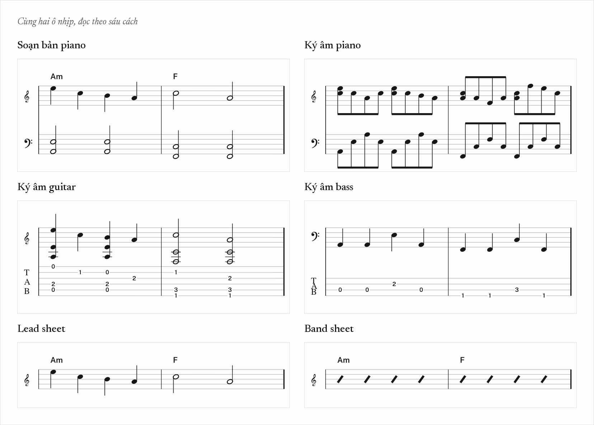

<a href="https://ledutu.com/scriptor/">
  <picture>
    <source media="(max-width: 600px)" srcset="assets/hero-mobile.svg">
    
  </picture>
</a>

  

Mình đang xây [Scriptor](https://ledutu.com/scriptor/) trong [ledutu](https://ledutu.com/): gửi link YouTube, TikTok, Instagram hoặc file ghi âm, Scriptor viết ra bản nhạc.

### Đưa link vào, nhận bản nhạc ra

**A. Đưa bản thu cho nó.** Dán link công khai hoặc gửi file ghi âm, không phải cài gì.

**B. Chọn mức độ chi tiết.** Chỉ hợp âm, một bản soạn hai tay, hay từng nốt mà bản thu chơi. Giá cho bài của bạn hiện ra trước khi xác nhận, và không bị trừ phí nếu quá trình thất bại.

**C. Mang lên giá nhạc.** In PDF, sửa MusicXML trong MuseScore hoặc Dorico, đưa MIDI vào DAW.

### Sáu cách để bài hát được viết ra

| Cách | Bạn nhận được | Thời gian xử lý |
|---|---|---|
| Soạn bản piano | Bản cover hai tay chơi được, theo 1 trong 21 phong cách nhạc sĩ | Khoảng bằng thời lượng video |
| Ký âm piano | Từng nốt một, sắc nét nhất với piano độc tấu | Khoảng 2,5 lần thời lượng |
| Ký âm guitar | Khuông nhạc kèm tab, dành cho bản thu guitar một mình | Khoảng 1,7 lần thời lượng |
| Ký âm bass | Dòng bass tách khỏi ban nhạc, khoá Fa kèm tab 4 dây | Khoảng 4,5 lần thời lượng |
| Lead sheet | Giai điệu giọng hát trên một khuông nhạc, tên hợp âm in phía trên | Khoảng 2 lần thời lượng |
| Band sheet | Tên hợp âm trên từng phách, chia theo các phần của bài | Khoảng 2 lần thời lượng |

Bản piano và lead sheet về dưới dạng PDF, MusicXML và MIDI. Bản tab guitar hoặc bass về dưới dạng Guitar Pro và MIDI. Không có gì bị khoá trong trình xem của ledutu.

### Trước khi bạn dán link

**Giá:** tính theo phút, không theo tháng. Bạn thấy con số chính xác cho bài của mình trước khi xác nhận.

**Độ chính xác:** tốt nhất với piano độc tấu. Với bản phối đầy đủ, kết quả chỉ là gần đúng và bạn thường sẽ phải sửa đôi chỗ.

### Ngoài Scriptor

[ledutu](https://ledutu.com/) còn có 60.000+ bài hát có hợp âm, 120 bài học miễn phí và 14 công cụ luyện tập. Mã nguồn mở: [pickfix-mcp](https://github.com/ledutu-studio/pickfix-mcp), ghim góp ý lên giao diện web rồi sửa ngay trong phiên Claude Code.

[YouTube](https://www.youtube.com/@ledutu), [TikTok](https://tiktok.com/@ledutu), [Instagram](https://instagram.com/imledutu), [Threads](https://www.threads.com/@imledutu), [Facebook](https://facebook.com/imledutu), [MuseScore](https://musescore.com/user/74087935), [Discord](https://discord.gg/W8N6cST84A).

In English

 

I'm building [Scriptor](https://ledutu.com/en/scriptor/) inside [ledutu](https://ledutu.com/en/): send a YouTube, TikTok or Instagram link or an audio file, and it writes out the sheet music. Piano transcription, playable piano arrangement, guitar tab, bass tab, lead sheet or band sheet. You see the price for your song before you confirm, and a failed run costs nothing.

